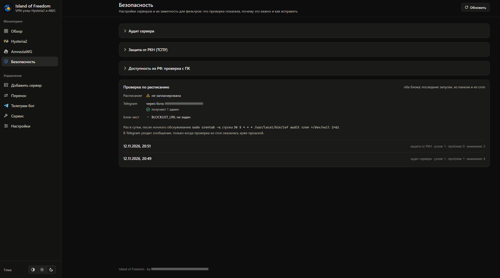
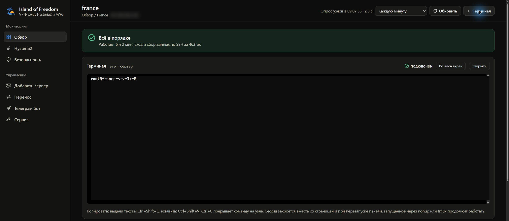

<p align="center">
  
</p>

<h1 align="center">Island Of Freedom</h1>

<p align="center">
  <a href="https://github.com/mEldevlp/iof/actions/workflows/ci.yml"></a>
  
  
  
  
  
</p>

**Island Of Freedom (iof)** - утилита с открытым исходным кодом и веб-панелью для управления VPN-серверами на протоколах
Hysteria 2 и Amnezia 2.0. Позволяет следить за состоянием серверов и управлять VPN через единый интерфейс. 
Так же позволяет администрировать сервера через подключённого Telegram-бота

Данная утилита разрабатывалась полностью для личного пользования, но я решил выложить исходный код. Данная панель не претендует на замену гигантам по типу 3x-ui, она для тех кому надоел нагромождённый интерфейс и хочет пользоваться
по принципу "накатил - работает".

> [!NOTE]
> Выбранные протоколы `Hysteria` и `Amnezia` выбраны потому что `VLESS` в моём регионе вообще на отрез
> отказывается работать. В планах есть всё же добавить поддержку этих протоколов


<details>
<summary>Ещё скриншоты: ссылки Hysteria2, аудит безопасности, терминал, добавление сервера, Telegram-бот</summary>







</details>

## Установка на Ubuntu 24.04

Выполните на сервере, с которого будете управлять остальными VPS:

```bash
sudo apt update && sudo apt install -y git python3 qrencode
sudo git clone https://github.com/mEldevlp/iof /opt/iof
sudo bash /opt/iof/install.sh
sudo iof status
```

## Обновление

На управляющем сервере:

```bash
sudo iof update
```

## Веб-панель

На своём компьютере откройте SSH-туннель к управляющему серверу:

```bash
ssh -N -L 127.0.0.1:8088:127.0.0.1:8088 пользователь@сервер
```
