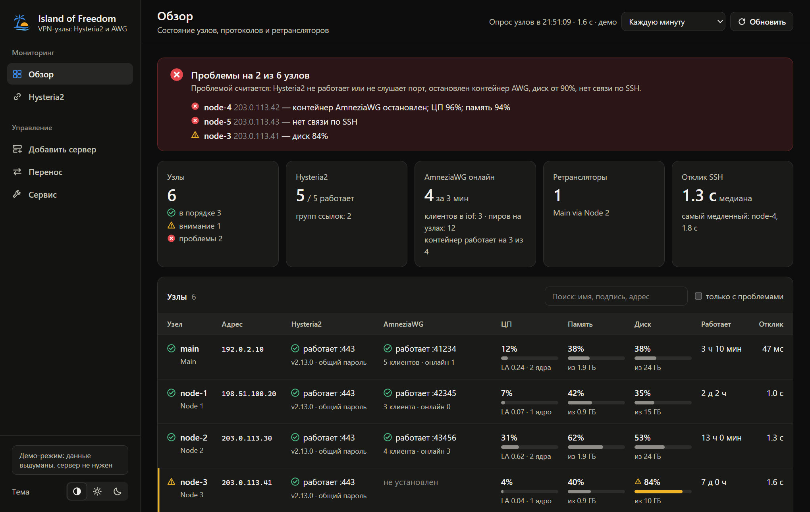
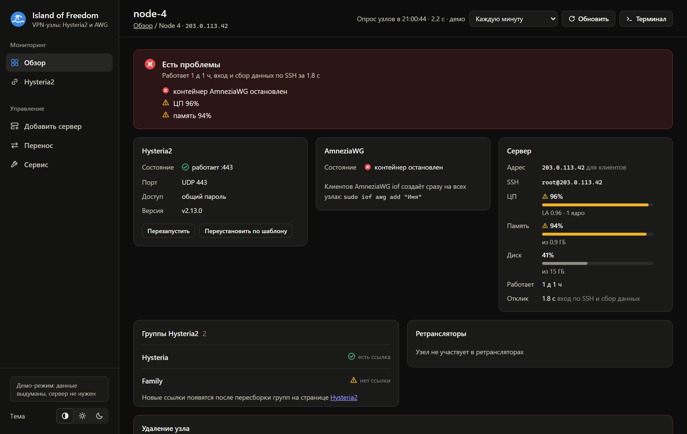
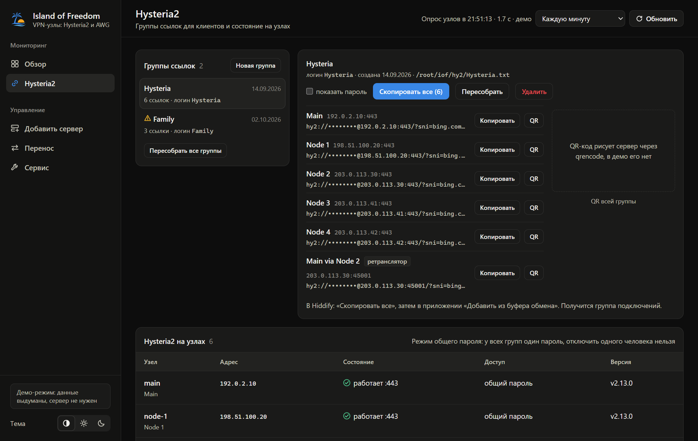
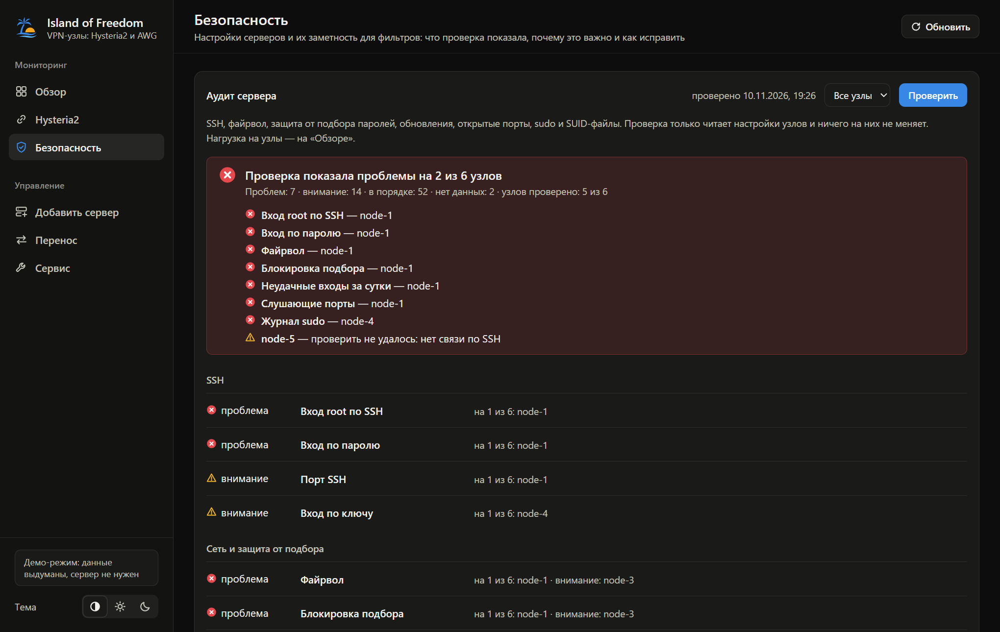
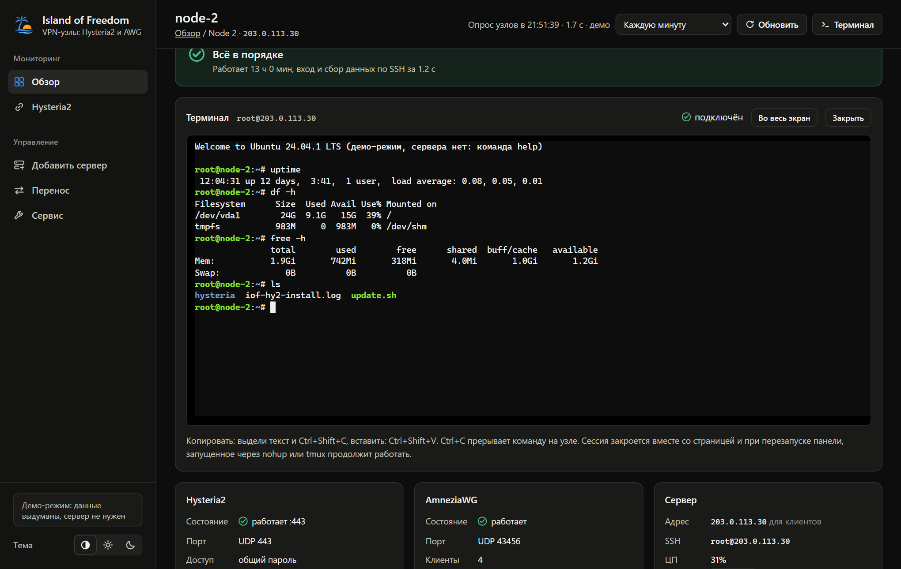
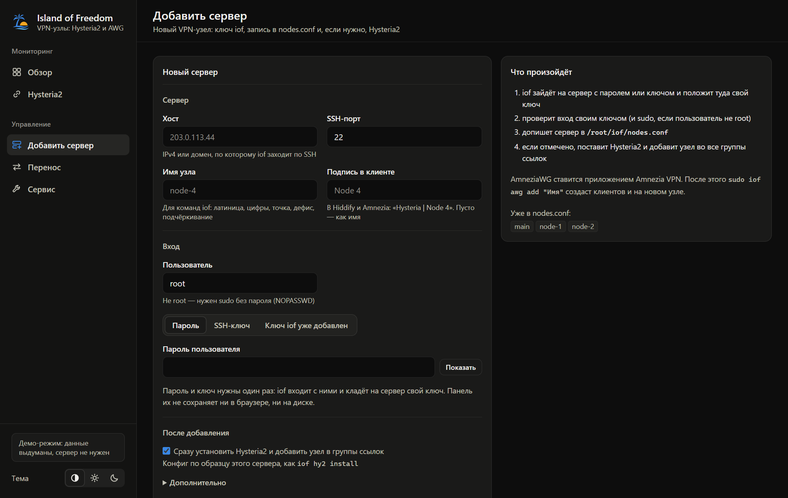

# iof (Island of Freedom)

[](https://github.com/mEldevlp/iof/actions/workflows/ci.yml)

Управление VPN-серверами (Hysteria2, AmneziaWG) с одного управляющего сервера по SSH
и веб-панель к нему.





<details>
<summary>Ещё скриншоты: ссылки Hysteria2, аудит безопасности, терминал, добавление сервера</summary>









</details>

<sub>Скриншоты сняты в демо-режиме панели, данные выдуманы. Открыть его самому:
<code>web/static/index.html?demo</code> через любой статический сервер.</sub>

## Установка

На управляющем сервере (Ubuntu 24.04):

```
sudo apt update && sudo apt install -y git python3 qrencode
sudo git clone https://github.com/mEldevlp/iof /opt/iof
sudo bash /opt/iof/install.sh
sudo iof status
```

Ставятся `iof`, `iof-nightly` и веб-панель. Данные в `/root/iof` не трогаются.

## Обновление

```
sudo iof update
```

Скачивает новую версию с GitHub и ставит её. Если в `iof.sh` ошибка, рабочий `iof` остаётся прежним.
Установленная версия: `sudo iof version`. То же самое можно сделать в панели на странице «Сервис».

## Веб-панель

Открывается только через SSH-туннель. На компьютере:

```
ssh -L 8088:127.0.0.1:8088 пользователь@сервер
```

и в браузере http://127.0.0.1:8088/

- **Обзор** — состояние всех серверов, как `iof status`. Клик по строке открывает страницу сервера:
  подробности, группы ссылок и ретрансляторы с ним, кнопки «Перезапустить Hysteria2»,
  «Установить» или «Переустановить по шаблону» и «Удалить узел» (`iof node del` + `iof refresh`).
- **Hysteria2** — группы ссылок: скопировать для Hiddify, QR-коды. Там же создать группу,
  пересобрать или удалить её и пересобрать все (`iof hy2 add`, `del`, `refresh`).
- **Безопасность** — аудит настроек серверов и их заметность для фильтров, см. ниже.
- **Добавить сервер** — новый сервер по паролю, SSH-ключу или уже добавленному ключу iof,
  сразу с установкой Hysteria2. Работает через `iof node add`, лог виден на странице.
- **Перенос** — перенос управления на другой сервер, см. ниже.
- **Сервис** — версия iof, проверка обновлений и кнопка «Обновить» (`iof update`, панель при этом
  перезапустится), когда и с каким итогом шла проверка узлов `iof check` и ночное обслуживание,
  настроен ли Telegram, последние задачи панели с логами.

Каждое действие в панели — команда iof, её лог виден на странице. Тема (светлая или тёмная)
переключается внизу меню.

### Терминал на сервер

На странице сервера кнопка «Терминал» открывает консоль прямо в браузере, как окно PuTTY:
панель заходит на сервер по SSH своим ключом iof (на сам управляющий сервер — оболочкой root).
Работают цвета, `htop`, `mc`, `nano`, Ctrl+C. Копировать: выдели текст и Ctrl+Shift+C,
вставить: Ctrl+Shift+V. Есть кнопка «Во весь экран». После `exit` Enter подключает снова.

Терминал даёт root-доступ ко всем серверам из браузера, поэтому по умолчанию он выключен.
Включить:

```
echo IOF_WEB_TERMINAL=1 | sudo tee -a /root/iof/web.env
sudo systemctl restart iof-web
```

Сессия закрывается вместе со страницей и при перезапуске панели (например, после `iof update`).
Запущенное через `nohup` или `tmux` продолжает работать. Одновременно открыто не больше
4 терминалов. Что набирают в терминале, панель не записывает, в `journalctl -u iof-web` видно только
открытие и закрытие.

## Аудит безопасности

`iof audit` проверяет настройки каждого сервера и по каждому пункту говорит, что нашёл, почему это
важно и какой командой исправить. На серверах он ничего не меняет.

```
sudo iof audit run            # проверить все серверы (или sudo iof -n de-1 audit run)
sudo iof audit run dpi        # только один блок: server или dpi
sudo iof audit show de-1      # последняя проверка сервера: все пункты и как исправить
```

Блоков два. **Аудит сервера** (`server`): вход root и вход по паролю в SSH, порт, вход по ключу;
файрвол и его политика по умолчанию; fail2ban или CrowdSec и порт его jail sshd; неудачные входы за сутки; слушающие порты
(SSH, Hysteria2, контейнер AmneziaWG и порты ретранслятора считаются ожидаемыми, остальные — лишними);
ожидающие обновления, нужна ли перезагрузка, когда отработал `iof-nightly`; журнал sudo, требования
к паролям, SUID-файлы вне стандартного набора Ubuntu 24.04.

Советы учитывают, что iof ходит на серверы по SSH-ключу: root предлагается оставить с входом
только по ключу, а команды для ufw сначала открывают порты SSH и VPN и только потом включают запрет.

**Защита от РКН (ТСПУ)** (`dpi`) показывает, чем сервер заметен для фильтров и зондов. Защиту она
не обещает: это список признаков и того, что с ними можно сделать.

- Hysteria2: режим маскировки (Salamander или masquerade), жива ли цель masquerade, как порт отвечает
  на зонд QUIC с управляющего сервера, порт, смена портов, отличается ли конфиг сервера от шаблона.
- AmneziaWG: не как у обычного WireGuard ли параметры обфускации, в допустимых ли они границах,
  одинаковые ли на разных серверах.
- Что видно снаружи: порты 80 и 443/tcp и сертификат на них, ответ на ping, имя сервера и PTR,
  приветствия лишних портов, не слушает ли панель внешний адрес.
- Блок-лист сканеров: применён ли на сервере (набор ipset `iof-block`, цепочка `IOF-BLOCK`). Сам iof
  список пока не применяет.
- Репутация адреса: сеть и хостер по whois, есть ли адрес в выгрузке реестра блокировок (только IPv4).
- Гигиена: срок хранения журнала systemd, уровень журнала Hysteria2, лог контейнера AmneziaWG, время.

Там, где правильного ответа нет (Salamander или masquerade, порт 443 или другой), проверка ставит
«внимание» или «нет данных» и объясняет компромисс. Пароли и параметры обфускации в результаты
не попадают: только «задано», совпадения и названия полей. Снаружи на серверы смотрит управляющий
сервер, поэтому его собственный файрвол в этих проверках не участвует, а запросы whois уходят
на whois.iana.org и в региональный реестр.

Списки для блок-листа и реестра задаются в `/root/iof/iof.env`, без них эти две проверки остаются
без оценки. Формат обоих: текст, по одному IP или CIDR в строке, `#` — комментарий. Скачанное лежит
в `/root/iof/audit/cache` и обновляется не чаще раза в сутки.

```
BLOCKLIST_URL="https://example.org/scanners.txt"
REGISTRY_URL="https://example.org/registry-ips.txt"
```

В панели то же самое на странице «Безопасность»: у каждого блока сводка, проверки по всем серверам
или по одному и кнопка «Проверить». Раз в сутки проверку можно запускать из cron (`sudo crontab -e`), тогда
в Telegram придёт сообщение, если какой-то пункт стал хуже прошлого раза:

```
30 5 * * * /usr/local/bin/iof audit cron >/dev/null 2>&1
```

Набор проверок составлен по мотивам [vps-audit](https://github.com/nuver-labs/vps-audit) (MIT),
сам скрипт не используется.

## Перенос управляющего сервера

Управление можно перенести на новый сервер (Ubuntu или Debian), а старый останется
обычным VPN-узлом. Клиенты подключаются к узлам напрямую, поэтому их ссылки и ключи
не меняются и перенос они не заметят.

1. В панели **старого** сервера: «Перенос» → хост нового сервера и пароль (или ключ) → «Начать перенос».
   iof поставит на новый сервер себя и панель, скопирует `/root/iof`, ключ iof и шаблон Hysteria2,
   проверит, что новый сервер видит все узлы. Изменения на старом сервере с этого момента блокируются.
2. Открой панель **нового** сервера (туннель на другом порту, чтобы не мешал старому):
   `ssh -L 8089:127.0.0.1:8088 root@новый-сервер`, затем http://127.0.0.1:8089/.
   На «Обзоре» проверь, что все узлы на связи.
3. Там же «Перенос» → «Завершить перенос». Со старого сервера уберутся панель, команды iof
   и задания cron (они переедут на новый), прежние данные iof останутся в `/root/iof.moved-…`.

До завершения перенос можно отменить кнопкой на старом сервере. То же из консоли:

```
sudo iof migrate start 203.0.113.50        # на старом
sudo iof migrate finish                    # на новом
sudo iof migrate cancel                    # на старом, отменить
```

Если какой-то узел не на связи с нового сервера, обычно SSH на нём открыт только для IP старого
(файрвол у хостера) или запрещён вход root по ключу.

## Тестовый стенд

Для проверки изменений без настоящих серверов: четыре контейнера Ubuntu 24.04 с systemd и SSH
(`old` — управляющий, `node1`, `node2`, `new` — для переноса). Нужен Linux или WSL с Docker Engine:

```
bash stand/stand.sh up       # поднять серверы
bash stand/stand.sh setup    # iof из рабочей копии на old, узлы, Hysteria2
bash stand/stand.sh test     # проверить узлы, туннели Hysteria2, ретранслятор, аудит, панель и терминал
bash stand/stand.sh tunnel   # панели: old http://localhost:8081/, new http://localhost:8082/
bash stand/stand.sh down     # убрать
```

Остальные команды: `bash stand/stand.sh` без аргументов.

## Проверки (CI)

На каждый push в master и на pull request GitHub Actions запускает две проверки:

- **Проверки кода** (`bash ci/lint.sh`, можно и локально): синтаксис скриптов, shellcheck,
  pyflakes для панели, синтаксис js, правила проекта (функции узла в `NODE_FUNCS`, файлы панели
  в `STATIC_FILES`, ничего, что запрещает CSP панели, одинаковое меню на всех страницах).
- **Стенд из двух серверов**: в Docker поднимаются управляющий сервер `old` и узел `node1`,
  на `old` ставится iof из этого коммита, он подключает `node1` по паролю и ставит Hysteria2 на оба.
  Затем `stand.sh test` проверяет, что всё работает: узлы на связи, VPN-туннели по выданным ссылкам
  между серверами, ретранслятор, аудит безопасности, веб-панель и её защита.

Workflow ничего не выкладывает на настоящие серверы: обновление по-прежнему `sudo iof update`.

## Ночное обслуживание

`iof-nightly` обновляет пакеты и перезагружает все серверы. Включить (`sudo crontab -e`):

```
0 4 * * * /usr/local/sbin/iof-nightly
```

## Если что-то не так

- Панель не открывается: `systemctl status iof-web`, `journalctl -u iof-web -n 50`.
- Вернуть прошлую версию: `sudo git -C /opt/iof log --oneline`, затем
  `sudo git -C /opt/iof checkout <коммит> && sudo bash /opt/iof/install.sh`.
  Обратно на свежую: `sudo git -C /opt/iof checkout master && sudo iof update`.
- Открыть панель без туннеля (за nginx с HTTPS): в `/root/iof/web.env` задать
  `IOF_WEB_PASSWORD=...` и `IOF_WEB_HOSTS=домен`. Без пароля панель наружу не запустится:
  через неё можно управлять всеми серверами. Терминалу nginx должен пропускать WebSocket:
  для `location /api/term/ws` нужны `proxy_http_version 1.1`,
  `proxy_set_header Upgrade $http_upgrade` и `proxy_set_header Connection "upgrade"`.
