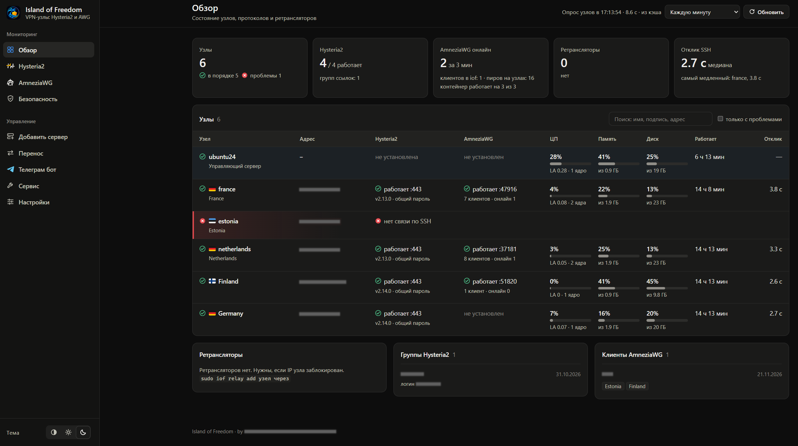
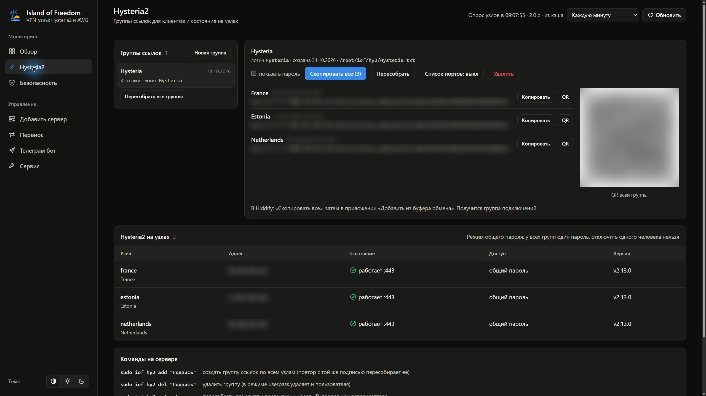
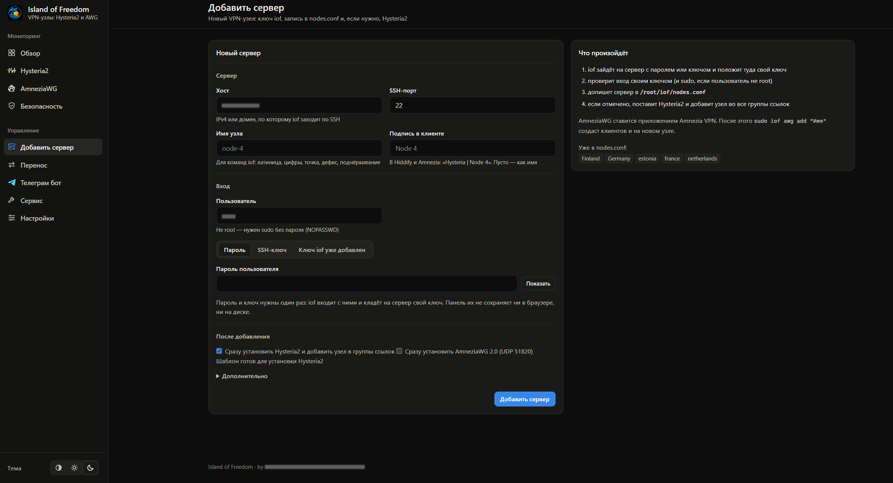
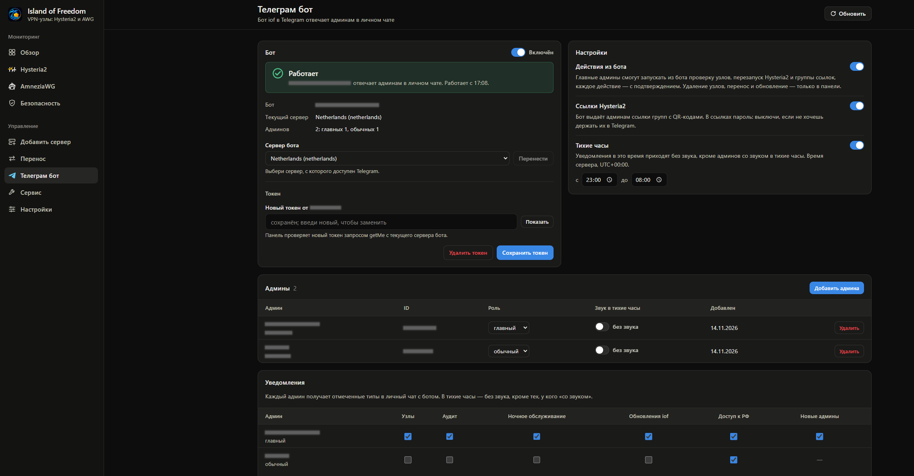

<p align="center">
  
</p>

<h1 align="center">Island Of Freedom</h1>

<p align="center">
  <a href="https://github.com/mEldevlp/iof/actions/workflows/ci.yml"></a>
  
  
  
  
  
</p>

**Island Of Freedom (iof)** - утилита с открытым исходным кодом и веб-панелью для управления VPN-серверами на протоколах
Hysteria 2 и Amnezia 2.0. Позволяет следить за состоянием серверов и управлять VPN через единый интерфейс. 
Так же позволяет администрировать сервера через подключённого Telegram-бота

Данная утилита разрабатывалась полностью для личного пользования, но я решил выложить исходный код. Данная панель не претендует на замену гигантам по типу 3x-ui, она для тех кому надоел нагромождённый интерфейс и хочет пользоваться
по принципу "накатил - работает".

> [!NOTE]
> Выбранные протоколы `Hysteria` и `Amnezia` выбраны потому что `VLESS` в моём регионе вообще на отрез
> отказывается работать. В планах есть всё же добавить поддержку этих протоколов



<details>
<summary>Ещё скриншоты: ссылки Hysteria2, аудит безопасности, терминал, добавление сервера, Telegram-бот</summary>









</details>

## Установка на Ubuntu 24.04 и вход веб панель с Windows

Выполните на сервере, с которого будете управлять остальными VPS:

```bash
sudo apt update && sudo apt install -y git python3 qrencode
sudo git clone https://github.com/mEldevlp/iof /opt/iof
sudo bash /opt/iof/install.sh

ssh -N -L 127.0.0.1:8088:127.0.0.1:8088 пользователь@сервер
```

При первой установке в терминале задайте логин и пароль панели. Логин по умолчанию — `admin`.
Нажмите Enter вместо ввода пароля, чтобы получить случайный пароль из 16 шестнадцатеричных
символов. Установщик покажет его один раз в терминале. При установке без терминала пароль
генерируется без вывода. Задать известный пароль можно командой `sudo iof web reset-password`.

При настроенном nginx админка открывается по `/admin/`, а клиентам можно дать ссылку `/status`

## Первый запуск на чистом сервере

Установщик запускает панель. Откройте её через SSH-туннель или по настроенному адресу HTTPS
и войдите. На «Обзоре» появится мастер установки VPN.

- **VPN на этом сервере** — укажите имя, IPv4 или домен для VPN-клиентов и подпись.
  Мастер создаст шаблон со случайным паролем, добавит управляющий сервер как узел `local`
  и установит Hysteria2. По умолчанию — UDP 443 без обфускации; можно выбрать другой порт
  и Salamander с отдельным случайным паролем.
- **Только управление** — мастер подготовит шаблон, не устанавливая Hysteria2 на управляющий
  сервер. Затем перейдите в «Добавить сервер» и включите установку Hysteria2 на удалённом узле.

После установки создайте группу на странице «Hysteria2» и импортируйте её ссылки в клиент.
Клиенты подключаются **непосредственно к узлам**, а не к SSH-туннелю панели: `localhost`
в качестве адреса узла не подходит. Для сервера за NAT нужен доступный клиентам адрес и
проброс выбранного UDP-порта.

Без панели доступны те же действия:

```bash
sudo iof setup                       # интерактивный мастер
# Или без вопросов:
sudo iof setup --name main --addr vpn.example.com --title "Мой VPS"
# Выделенный управляющий сервер:
sudo iof setup --template-only
# После установки VPN:
sudo iof hy2 add "Мои устройства"
sudo iof status
```

## Обновление

На странице «Сервис» нажмите «Проверить обновления», затем «Обновить». Панель ставит последний
опубликованный стабильный релиз GitHub. Из терминала управляющего сервера:

```bash
sudo iof update --release
```

Если установленная версия появилась до `v0.9`, сначала установите `v0.9` из клона:

```bash
sudo git -C /opt/iof fetch origin tag v0.9
sudo git -C /opt/iof checkout --detach v0.9
sudo bash /opt/iof/install.sh
```

Первый [релиз iof](https://github.com/mEldevlp/iof/releases) имеет номер `v0.9`. После успешной проверки
нового коммита `master` GitHub Actions выпускает следующую версию: `v0.10`, `v0.11` и далее.
