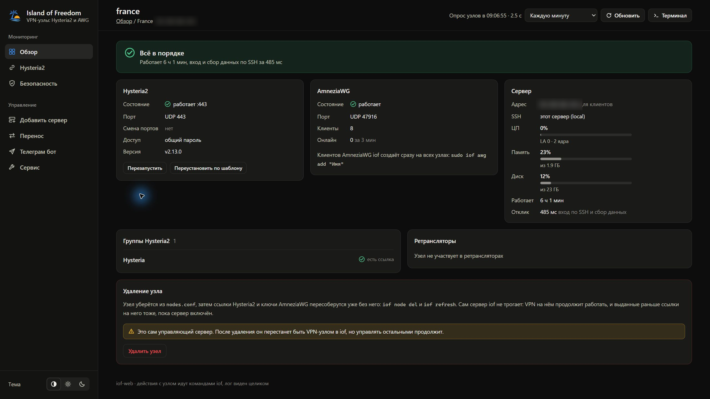

<p align="center">
  
</p>

<h1 align="center">Island Of Freedom</h1>

<p align="center">
  <a href="https://github.com/mEldevlp/iof/actions/workflows/ci.yml"></a>
  
  
  
  
  
</p>

**Island Of Freedom (iof)** - утилита с открытым исходным кодом и веб-панелью для управления VPN-серверами на протоколах
Hysteria 2 и Amnezia 2.0. Позволяет следить за состоянием серверов и управлять VPN через единый интерфейс. 
Так же позволяет администрировать сервера через подключённого Telegram-бота

Данная утилита разрабатывалась полностью для личного пользования, но я решил выложить исходный код. Данная панель не претендует на замену гигантам по типу 3x-ui, она для тех кому надоел нагромождённый интерфейс и хочет пользоваться
по принципу "накатил - работает".

> [!NOTE]
> Выбранные протоколы `Hysteria` и `Amnezia` выбраны потому что `VLESS` в моём регионе вообще на отрез
> отказывается работать. В планах есть всё же добавить поддержку этих протоколов




<details>
<summary>Ещё скриншоты: ссылки Hysteria2, аудит безопасности, терминал, добавление сервера, Telegram-бот</summary>


</details>

## Установка на Ubuntu 24.04

Выполните на сервере, с которого будете управлять остальными VPS:

```bash
sudo apt update && sudo apt install -y git python3 qrencode
sudo git clone https://github.com/mEldevlp/iof /opt/iof
sudo bash /opt/iof/install.sh
```

При первой установке в терминале задайте логин и пароль панели. Логин по умолчанию — `admin`.
Нажмите Enter вместо ввода пароля, чтобы получить случайный пароль из 16 шестнадцатеричных
символов. Установщик покажет его один раз в терминале. При установке без терминала пароль
генерируется без вывода. Задать известный пароль можно командой `sudo iof web reset-password`.

## Первый запуск на чистом сервере

Установщик запускает панель. Откройте её через SSH-туннель или по настроенному адресу HTTPS
и войдите. На «Обзоре» появится мастер установки VPN.

- **VPN на этом сервере** — укажите имя, IPv4 или домен для VPN-клиентов и подпись.
  Мастер создаст шаблон со случайным паролем, добавит управляющий сервер как узел `local`
  и установит Hysteria2. По умолчанию — UDP 443 без обфускации; можно выбрать другой порт
  и Salamander с отдельным случайным паролем.
- **Только управление** — мастер подготовит шаблон, не устанавливая Hysteria2 на управляющий
  сервер. Затем перейдите в «Добавить сервер» и включите установку Hysteria2 на удалённом узле.

После установки создайте группу на странице «Hysteria2» и импортируйте её ссылки в клиент.
Клиенты подключаются **непосредственно к узлам**, а не к SSH-туннелю панели: `localhost`
в качестве адреса узла не подходит. Для сервера за NAT нужен доступный клиентам адрес и
проброс выбранного UDP-порта.

**Откройте выбранный UDP-порт в файрволе провайдера/security group VPS.** Активный UFW на
самом узле настраивается установщиком; другие правила firewall мастер не меняет.
Сертификат самоподписанный, создаётся отдельно на каждом VPN-узле; штатные ссылки iof
содержат параметры его проверки. Доступность через провайдера клиента мастер не доказывает.

Без панели доступны те же действия:

```bash
sudo iof setup                       # интерактивный мастер
# Или без вопросов:
sudo iof setup --name main --addr vpn.example.com --title "Мой VPS"
# Выделенный управляющий сервер:
sudo iof setup --template-only
# После установки VPN:
sudo iof hy2 add "Мои устройства"
sudo iof status
```

Повтор с теми же параметрами не меняет пароли и не создаёт второй узел. После сбоя исправьте
причину из лога и повторите команду. Существующие шаблоны, VPN-конфиги и ключи не заменяются;
если обнаружена неизвестная остановленная установка Hysteria2, мастер предложит сначала
восстановить её вручную. Шаблон чистой установки хранится в `/root/iof/hy2-template.yaml`.
`iof init` создаёт пустой список узлов с примерами только в комментариях.

## AmneziaWG 2.0

На странице узла нажмите **Установить AmneziaWG 2.0**. При добавлении нового сервера можно
поставить AmneziaWG сразу. Для новой установки нужны Ubuntu 24.04 (amd64), устройство
`/dev/net/tun` и входящий UDP-порт 51820 или выбранный вами порт.

В разделе **AmneziaWG** нажмите **Добавить клиента**, затем скопируйте ключ `vpn://` нужного узла.
В приложении Amnezia VPN откройте **+ → Вставить ключ**. У каждого узла свой ключ.

Те же действия доступны с управляющего сервера:

```bash
sudo iof awg install node-1
sudo iof awg add "Моё устройство"
sudo iof awg keys "Моё устройство"
```

## Обновление

На управляющем сервере:

```bash
sudo iof update
```

Обновление и повторная установка сохраняют логин и пароль панели. При переходе со старой версии
установщик переносит `IOF_WEB_PASSWORD` из `/root/iof/web.env` в хеш и удаляет строку с паролем.
После перехода войдите с логином `admin` и прежним паролем.

## Веб-панель

### Через SSH-туннель

На своём компьютере откройте SSH-туннель к управляющему серверу:

```bash
ssh -N -L 127.0.0.1:8088:127.0.0.1:8088 пользователь@сервер
```

Откройте <http://127.0.0.1:8088/> или <http://127.0.0.1:8088/admin/> в браузере и войдите. Оставьте SSH-туннель
работающим, пока пользуетесь панелью. `8088/tcp` слушает только `127.0.0.1` на сервере.

### Напрямую по HTTPS

Для адреса `https://ostrovsvobodi.ru/admin` направьте DNS-запись `A` домена на публичный IPv4
управляющего сервера. Добавляйте `AAAA`, только если сервер принимает входящие подключения по IPv6
на тех же портах. Для входа без домена используйте `https://ПУБЛИЧНЫЙ_IP/admin` и отдельный сертификат
с этим IP. Сертификат домена подходит для входа по домену.

Откройте `80/tcp` для проверки ACME и перенаправления на HTTPS, а `443/tcp` для панели в файрволе сервера
и у провайдера. Hysteria2 по умолчанию использует `443/udp`. Если на сервере уже есть nginx с HTTPS,
подключите [настройку панели](web/nginx-iof.conf) внутри соответствующего HTTPS-блока `server`.

Для новой настройки установите nginx и [Certbot из snap](https://certbot.eff.org/instructions?os=snap&ws=nginx).
Для сертификата IP нужен Certbot 5.4 или новее. В примерах замените `203.0.113.10` публичным IPv4 сервера.
Оставьте в `server_name` адреса, которыми будете пользоваться. Создайте каталог `/var/www/iof-acme`,
сохраните HTTP-блок в `/etc/nginx/conf.d/iof.conf` и проверьте его командой `sudo nginx -t`.
Запустите nginx командой `sudo systemctl enable --now nginx` и перечитайте настройки командой
`sudo systemctl reload nginx`.

```nginx
server {
    listen 80;
    server_name ostrovsvobodi.ru 203.0.113.10;
    location ^~ /.well-known/acme-challenge/ { root /var/www/iof-acme; }
    location / { return 308 https://$host$request_uri; }
}
```

Выполните команду для домена, IP или обе. Let's Encrypt выпускает сертификаты для IP с профилем
`shortlived`, поэтому они требуют автоматического продления. [Справка Let's Encrypt](https://letsencrypt.org/2026/03/11/shorter-certs-certbot)

```bash
sudo certbot certonly --webroot -w /var/www/iof-acme --cert-name iof-domain -d ostrovsvobodi.ru
sudo certbot certonly --webroot -w /var/www/iof-acme --cert-name iof-ip --preferred-profile shortlived --ip-address 203.0.113.10
```

Добавьте в тот же файл HTTPS-блоки для выпущенных сертификатов. Если `443/tcp` уже обслуживает сайты,
включите фрагмент в действующую конфигурацию. Для входа по IP сертификат IP должен отдаваться сайтом по
умолчанию на этом адресе, так как клиент может открыть TLS-соединение без имени SNI.

```nginx
server {
    listen 443 ssl;
    server_name ostrovsvobodi.ru;
    ssl_certificate /etc/letsencrypt/live/iof-domain/fullchain.pem;
    ssl_certificate_key /etc/letsencrypt/live/iof-domain/privkey.pem;
    include /opt/iof/web/nginx-iof.conf;
    location / { return 404; }
}

server {
    listen 443 ssl default_server;
    server_name 203.0.113.10;
    ssl_certificate /etc/letsencrypt/live/iof-ip/fullchain.pem;
    ssl_certificate_key /etc/letsencrypt/live/iof-ip/privkey.pem;
    include /opt/iof/web/nginx-iof.conf;
    location / { return 404; }
}
```

Если настроили `AAAA`, добавьте в HTTP-блок `listen [::]:80;` и в HTTPS-блок домена `listen [::]:443 ssl;`.
В файле `/root/iof/web.env` задайте `IOF_WEB_HOSTS=ostrovsvobodi.ru,203.0.113.10` с нужными адресами
через запятую. Проверьте и примените конфигурацию:

```bash
sudo systemctl restart iof-web
sudo nginx -t && sudo systemctl reload nginx
```

Убедитесь, что таймер продления Certbot включён (`systemctl list-timers --all | grep certbot`).
Чтобы nginx перечитывал обновлённые сертификаты, создайте исполняемый файл
`/etc/letsencrypt/renewal-hooks/deploy/iof-nginx` с таким содержимым и проверьте продление
командой `sudo certbot renew --dry-run`:

```sh
#!/bin/sh
systemctl reload nginx
```

### Смена и сброс пароля

В меню панели откройте «Настройки». Введите текущий пароль, новый пароль и его подтверждение.
Если забыли пароль, зайдите на управляющий сервер по SSH и выполните:

```bash
sudo iof web reset-password
```

Введите новый пароль дважды или нажмите Enter, чтобы получить случайный. Логин сохраняется.
После смены или сброса все сеансы панели и открытые в ней терминалы закрываются. Войдите снова
через HTTPS или SSH-туннель. Пароль хранится в виде хеша в `/root/iof/web-auth.json`.
